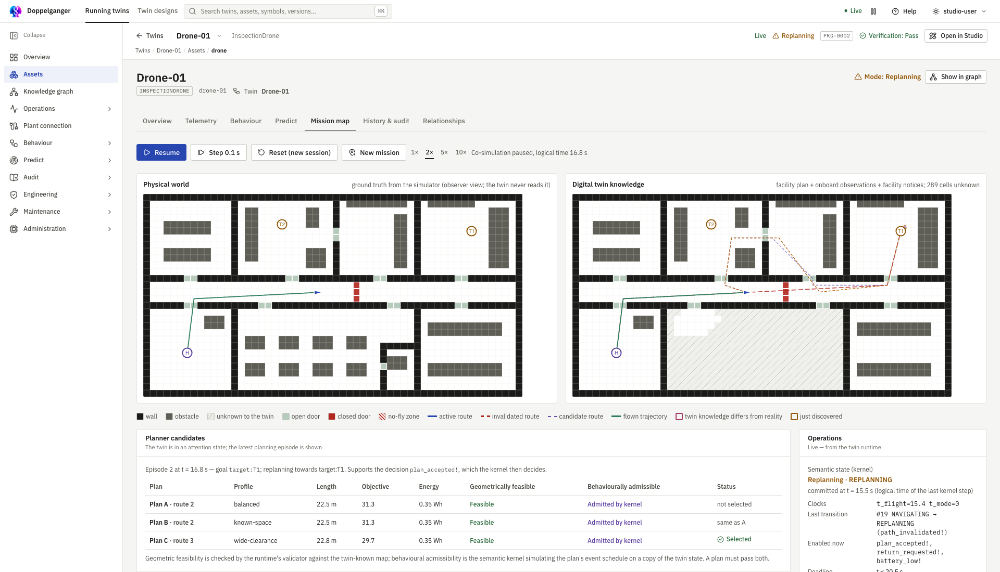

## Choose your path

- **New to the project?** Read [installation](installation.md), then follow [create your first twin](tutorial-first-twin.md).
- **Using an existing twin?** Start with [running twins](operations.md) and [connect a real system](tutorial-connect-real-twin.md).
- **Extending the code?** Read the [architecture](architecture.md), [developer guide](developer.md), and [contribution guide](contributing.md).

The shipped drone example in Doppelganger. The physical simulation and the twin's known map are shown side by side.

The documentation is a static site. Search, images, and page navigation work without the application, database or any runtime service.
