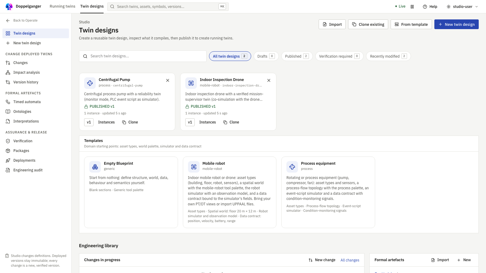

# Getting started

## Open the right area

Use the top bar to switch between **Twin designs** and **Running twins**. A twin design is the reusable recipe. A running twin is a particular instance made from a published recipe.

The demo starts with a process pump and an inspection drone. This view shows running instances, not editable designs.

On **Twin designs**, choose **New twin design**. Choose **Blank twin design**, a template, a clone, an exported bundle, or formal files. For the normal new workflow, pick blank and then **Create twin design** on the identity step. This opens the new graphical editor.

The design library lists reusable definitions and their versions.

## Your first editing session

The editor has three tabs:

1. **Structure**: add types, parts, properties, events, actions and relationships. Double-click empty canvas space to add an asset; select an element to edit it on the right. The left explorer lets you switch types.
2. **Behavior**: draw states and connect them with event, action or timeout transitions. Select each state or transition to set meanings and time limits.
3. **Generated**: inspect the compiled timed automaton, formal ontology, RDF schema, knowledge graph and contract. This view refreshes after the design saves.

The **Twin design** item at the top of the explorer opens the inspector for extra formal ontology declarations. An asset type's **Formal assumptions** section adds axioms for that type. State and event **Means** fields build the interpretation. The formal ontology is more expressive than the knowledge graph.

Studio saves edits automatically. **Save** forces a save; **Validate** opens the Problems drawer. Rename, move and edit operations share one undo history. If the server reports a problem, click it to return to the relevant element.

## From design to running twin

**Publish** opens the advanced release area. Complete its verification steps and build a package. A published version is immutable. Under **Release → Instances**, create a running twin from that version. Use **Running twins** for deployment, telemetry, monitoring, prediction and replay.

## Library actions

The Studio sidebar has separate lists for **Ontologies**, **Interpretations** and **Timed automata**. These are versioned formal artefacts used by designs and advanced engineering. Select rows with the left checkboxes to **Export** or **Delete** them from the library. Delete asks for confirmation and retains saved versions required by existing designs and running twins. Export opens a save picker in supported browsers; otherwise the browser downloads the file.

For a complete guided example, continue to [Create your first twin](tutorial-first-twin.md).
