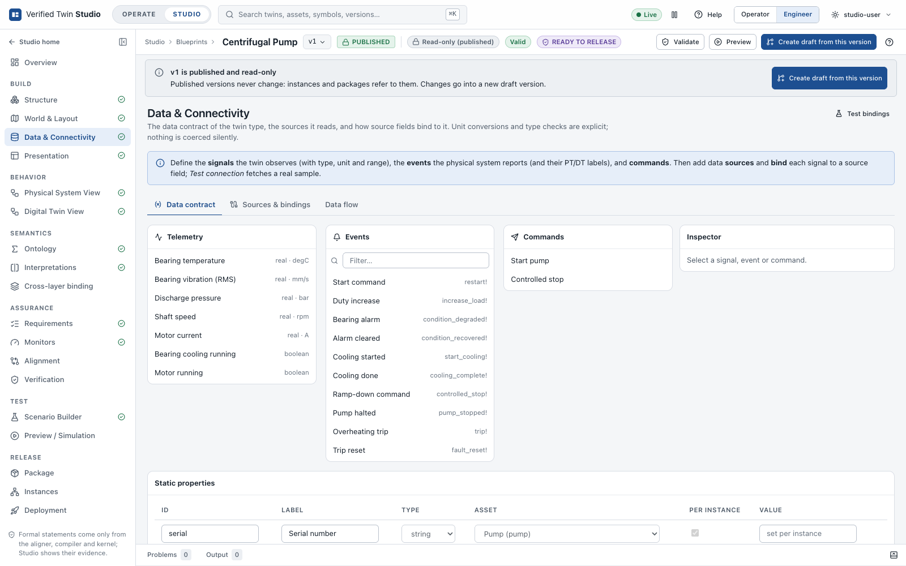
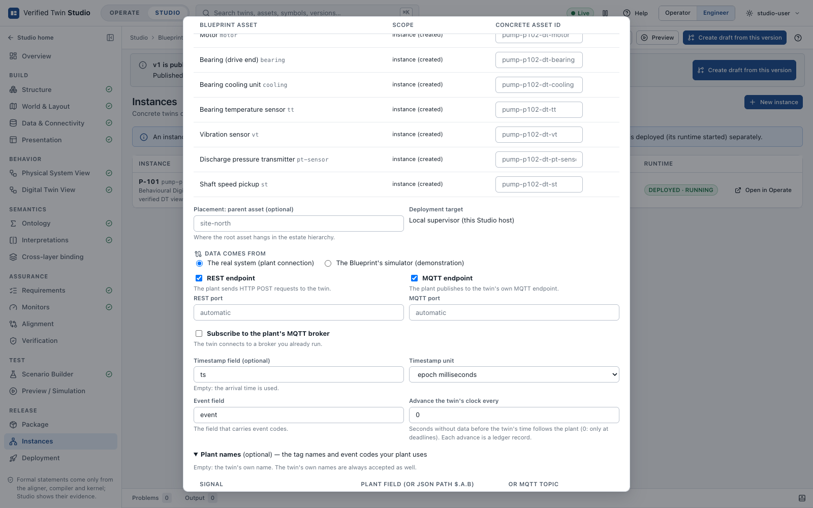
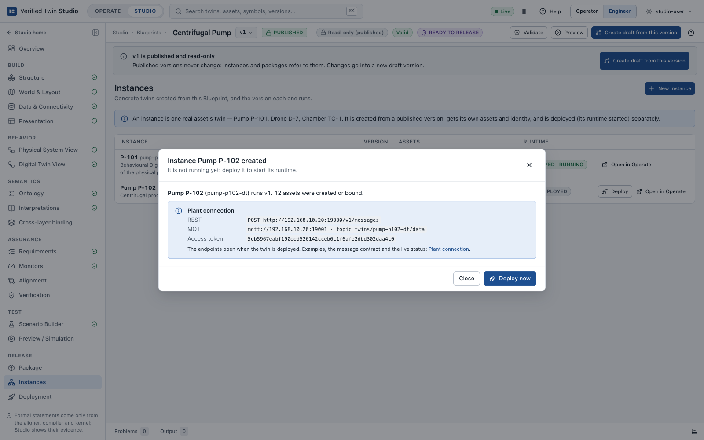
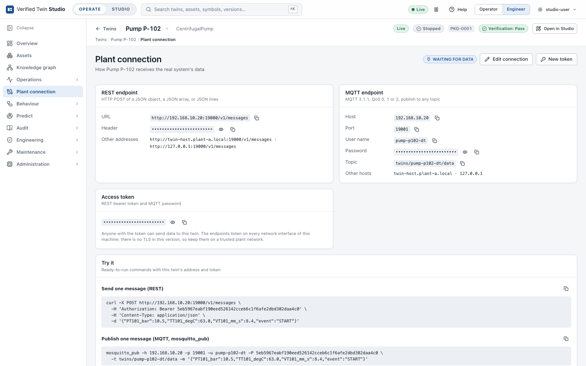
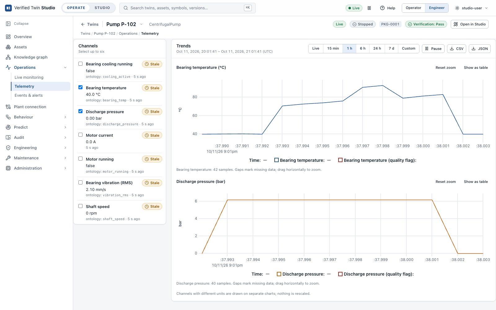
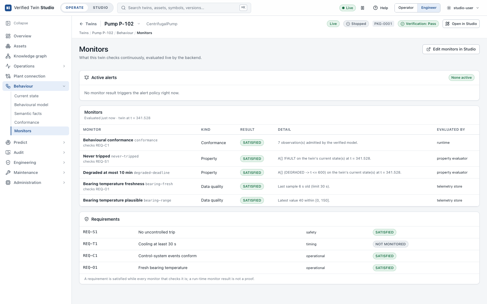
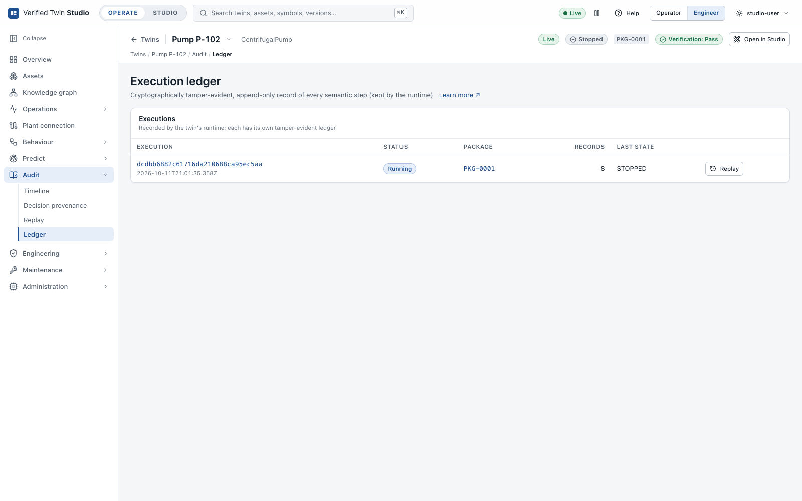
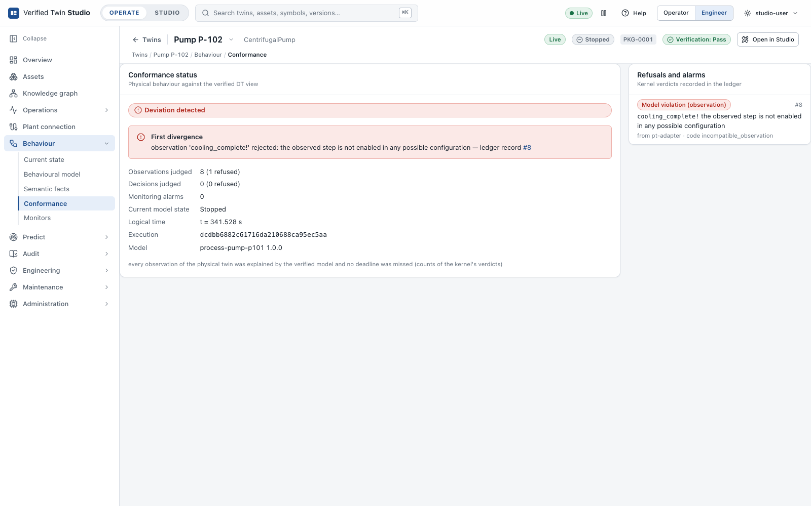
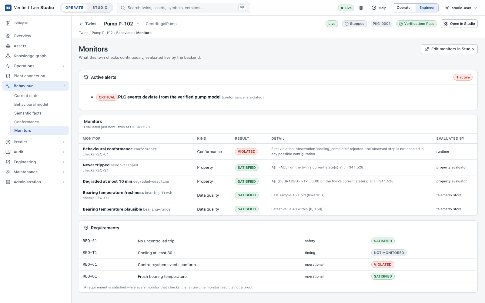

# Tutorial: connect a real twin

In this tutorial you connect a real physical system to a deployed twin. Your plant (a PLC, a
gateway or a historian) sends its events and measurements straight to the twin over **REST** or
**MQTT**. The twin's semantic kernel follows the plant step by step and records every decision
in the instance's ledger. You install nothing: when you create the instance you choose its
inputs, Studio starts them with the twin, and the instance's **Plant connection** page shows
everything the plant needs (addresses, ports, access token, topics, message format).

The example is the centrifugal pump that ships with the product, fed from a recorded log of a
real PLC. The same steps work for any published Blueprint, for example the one from
[Build your first twin](tutorial-first-twin.md). Every command and screenshot below was
produced on the running product.

## How a real twin is fed

```
 plant (PLC / gateway / historian)
        │  JSON over HTTP POST, or MQTT publish (or the twin subscribes to your broker)
        ▼
 twin-ingest   the instance's plant connection, started and supervised with the twin:
        │      maps the plant's names, places each message in logical time; decides nothing
        ▼
 twin-runtime (semantic kernel)   accepts or rejects each event → ledger
        └── telemetry → Studio history, monitors, Operate
```

Each instance can have up to three inputs, in any combination:

| Input | Who connects | Use it when |
|---|---|---|
| **REST endpoint** | The plant sends `POST http://<host>:<port>/v1/messages` | Your gateway or historian can make HTTP requests, or you replay a recorded log |
| **MQTT endpoint** | The plant publishes to the twin's own MQTT endpoint | Your devices speak MQTT and can point at a new server |
| **Broker subscription** | The twin subscribes to your existing broker | Your plant already publishes to a broker (Mosquitto, HiveMQ, EMQX, …) |

Three rules apply whatever the input:

- **Names are mapped, not guessed.** The plant may use its own tag names (`TT101_degC`) and
  event codes (`START`). You declare them once as the instance's *plant names*. The twin's own
  names (`bearing_temp`, `start_command`, the PT label `start_cmd!`) are always accepted as
  well. A code that matches nothing is reported and never sent.
- **The kernel decides.** An event that the verified model allows from the current state is
  accepted. Any other event is rejected, and the rejection is recorded as a conformance
  violation. Nothing else changes the twin's state.
- **Time is logical.** Messages with a plant timestamp keep their spacing; messages without
  one are placed at their arrival time. Logical time never goes backwards. No real-time
  guarantee is claimed.

## Step 1: know the contract

Open **Studio → Blueprints → Centrifugal pump → Build → Data**. The data contract lists what
the twin understands:

- **Telemetry**: `bearing_temp` (°C), `vibration_rms` (mm/s), `discharge_pressure` (bar),
  `shaft_speed` (rpm), `motor_current` (A), `cooling_active` and `motor_running`.
- **Events**: start command, duty increase, bearing alarm, alarm cleared, cooling started,
  cooling done, ramp-down command, pump halted, overheating trip and trip reset, each with its
  PT label (`start_cmd!`, `duty_up!`, …).



The PLC of pump P-102 uses its own vocabulary. Its recorded log,
[`examples/real-twin/plc-p102.jsonl`](../../examples/real-twin/plc-p102.jsonl), has one JSON
object per line:

```json
{"ts": 1760176805000, "TT101_degC": 70.2, "VT101_mm_s": 2.1, "PT101_bar": 6.2, "ST101_rpm": 2950, "IT101_A": 41.5, "cooling": false, "running": true, "event": "START"}
```

## Step 2: create the instance with a plant connection

Open the Blueprint's **Release → Instances → New instance**:

1. Give the instance id `pump-p102-dt` and the name `Pump P-102`.
2. Under **Data comes from**, choose **The real system (plant connection)**.
3. Tick **REST endpoint** and **MQTT endpoint**. Leave the ports empty: Studio picks free ones
   (from 19000 up) and keeps them for this instance. Type a port to choose it yourself.
4. Set the **Timestamp field** to `ts`, in **epoch milliseconds**.
5. Open **Plant names** and enter the PLC's tags (`TT101_degC` for bearing temperature,
   `VT101_mm_s`, `PT101_bar`, `ST101_rpm`, `IT101_A`, `cooling`, `running`) and its event codes
   (`START`, `DUTY_UP`, `BEARING_ALARM`, `ALARM_CLEARED`, `AUX_COOLING_ON`, `AUX_COOLING_DONE`,
   `STOP`, `STOPPED`, `TRIP`, `TRIP_RESET`).



Press **Create instance**. The addresses and the access token exist at once, before the twin
runs:



The same with the API, using the connection settings of
[`examples/real-twin/pump-p102.connection.json`](../../examples/real-twin/pump-p102.connection.json):

```bash
python3 - <<'EOF' > create.json
import json
conn = json.load(open("examples/real-twin/pump-p102.connection.json"))
print(json.dumps({"blueprintId": "centrifugal-pump", "version": 1, "id": "pump-p102-dt",
                  "name": "Pump P-102", "connection": conn}))
EOF
curl -s -X POST -H 'Content-Type: application/json' --data-binary @create.json \
  http://127.0.0.1:8080/api/v1/instances
```

## Step 3: deploy

Press **Deploy now** (or **Deploy** on the instance, or
`POST /api/v1/instances/pump-p102-dt/deploy`). The supervisor starts the twin's runtime in
monitor mode, then its plant connection (`twin-ingest`), and opens **Operate → Pump P-102 →
Plant connection**:



The page shows:

- **REST endpoint**: the URL and the `Authorization: Bearer <token>` header;
- **MQTT endpoint**: host, port, user name (the instance id), password (the token) and a topic
  (`twins/pump-p102-dt/data`; any topic is accepted);
- **Access token**, with **New token** to replace it (the old one stops working at once);
- **Try it**: ready-to-run `curl` and `mosquitto_pub` commands with this twin's address and
  token;
- **Live status** and the **Message contract** (below).

The endpoints listen on every network interface of the Studio machine. The addresses shown
are the machine's own; set `TWIN_STUDIO_PLANT_HOSTS` (for example
`TWIN_STUDIO_PLANT_HOSTS=twin-host.plant-a.local`) before starting Studio to advertise a DNS
name or the address the plant sees through NAT instead.

## Step 4: send data

Copy the address and the token from the page (here `192.168.10.20`, REST port 19000, MQTT port
19001).

**One message over REST:**

```bash
curl -X POST http://192.168.10.20:19000/v1/messages \
  -H 'Authorization: Bearer <token>' -H 'Content-Type: application/json' \
  -d '{"TT101_degC": 40.1, "running": false}'
```

The answer gives, for each message, its logical time, the telemetry samples forwarded, and for
each event (`"event": "START"`) the kernel's verdict (`accepted`, the twin's label, `from` and
`to`). This message has no `ts`, so its arrival time is used.

**One message over MQTT** (`mosquitto_pub` comes with Mosquitto, for example
`brew install mosquitto`; any MQTT 3.1.1 client works, with QoS 0, 1 or 2):

```bash
mosquitto_pub -h 192.168.10.20 -p 19001 -u pump-p102-dt -P <token> \
  -t twins/pump-p102-dt/data -m '{"TT101_degC": 40.3, "running": false}'
```

On per-tag topics, a payload can also be a bare value (`71.5`): give the signal an MQTT topic
in its plant names (for example `plant/line4/pump/TT101`).

**A recorded log in one request** (a JSON array or JSON lines):

```bash
curl -X POST http://192.168.10.20:19000/v1/messages -H 'Authorization: Bearer <token>' \
  --data-binary @examples/real-twin/plc-p102.jsonl
```

The log drives the twin through one operating cycle, keeping the PLC's spacing in time (its
first timestamped message is placed at the twin's present; logical time follows the plant's
clock from then on, so do not mix a recording with live data in one deployment):

```
{"eventsAccepted": 7, "eventsRejected": 0, "problems": 0, "telemetrySamples": 280, "unmapped": 0}
start_cmd! → restart!                    STOPPED → NORMAL
duty_up! → increase_load!                NORMAL → NORMAL
alarm_raise! → condition_degraded!       NORMAL → DEGRADED
aux_cooling_on! → start_cooling!         DEGRADED → COOLING
aux_cooling_done! → cooling_complete!    COOLING → NORMAL
ramp_down_cmd! → controlled_stop!        NORMAL → STOPPING
halted! → pump_stopped!                  STOPPING → STOPPED
```

**Your existing broker**: choose **Edit connection → Subscribe to the plant's MQTT broker**,
and give the broker's host, port, topics (for example `plant/line4/pump/#`), QoS and, if
needed, a user name and password. The password is kept by Studio on this machine, outside its
database, and never shown again. The twin reconnects by itself (back-off up to 30 s); the
page shows the broker's state and the last error.

## Step 5: watch it in Operate

The **Plant connection** page shows what arrives: messages, telemetry samples, the events the
twin accepted or rejected, unknown event codes, values of the wrong type, the MQTT clients
connected and the latest notices.


The rest of Operate works on the plant's data as on any twin's: telemetry history, monitors,
the formal state and the ledger.





The execution ledger contains every accepted step, hash-chained:



## What a deviation looks like

Here the PLC reports `AUX_COOLING_DONE` while the pump is stopped:

```bash
mosquitto_pub -h 192.168.10.20 -p 19001 -u pump-p102-dt -P <token> \
  -t twins/pump-p102-dt/data -m '{"event": "AUX_COOLING_DONE"}'
```

The verified model does not allow that event in that state, so the kernel rejects it: the
twin's state does not change, and a conformance violation is recorded in the ledger and shown
in Operate.





**Missed deadlines.** Some states of the verified model have a deadline (an invariant: for
example, a stopping pump must report it has stopped within its ramp-down time). While the twin
is in such a state, its plant connection watches the clock. If the plant's time passes the
deadline (by more than a grace period of 0.5 s, for network delays) without an event, it asks
the twin to let that time pass. The kernel refuses, the missed deadline is recorded in the
ledger, and the Plant connection page reports it. After that the connector stops moving the
twin's time on its own; later events are judged by the kernel as they come.

A deviation means that the plant and its verified model disagree. Investigate it: the plant may
have misbehaved, a signal may be wrongly mapped, or the model may need a new version. Studio
never adjusts the twin to make the data fit.

## Troubleshooting

| Symptom | Cause |
|---|---|
| `401 unauthorized` (REST) or `bad user name or password` (MQTT) | The token is missing or wrong, or it was replaced with **New token**. Copy it again from the Plant connection page. |
| Deploy fails: *cannot listen on 0.0.0.0:19000* | Another program uses the port. Choose another port in **Edit connection**. Ports from 18100 to 18999 are reserved for twin runtimes. |
| *Unknown event codes* increases | The plant sends a code that no event's plant names list. Add it under **Edit connection → Plant names**. |
| *Values of the wrong type* increases | A value does not convert to the signal's type (for example text for a number). It is reported, never coerced. |
| An event is `REJECTED` | The plant did something the verified model does not allow from the twin's current state: a conformance violation, by design. |
| *late* notices | A message is older than the previous one. It is placed at the last time used: logical time never goes back. A plant clock that jumps back by more than a minute is re-anchored. |
| Broker state *retrying* | The broker is unreachable or refused the connection or the subscription; the page shows the broker's answer. |
| Nothing arrives, status *NOT DEPLOYED* | The endpoints open with the twin: deploy the instance. |

## Security and limits

- **Access token.** Every REST request and every MQTT connection must carry the instance's
  token. Anyone with it can send data to the twin; replace it with **New token** if it leaks.
- **No TLS in this version.** The endpoints listen on every network interface, in clear text.
  Keep them on a trusted plant network, or put a TLS-terminating proxy in front of them.
  Studio itself has no authentication: keep it on `127.0.0.1` or behind an authenticating
  proxy.
- **The MQTT endpoint is receive-only.** It accepts publishes (QoS 0, 1 and 2) and refuses
  subscriptions: it is not a general broker. MQTT 3.1.1 and 3.1 are supported, MQTT 5 is not.
- **No OPC UA client** in this version.
- **Logical time only.** Wall-clock time only positions the plant's data on the twin's time
  line; no real-time guarantee is claimed.
