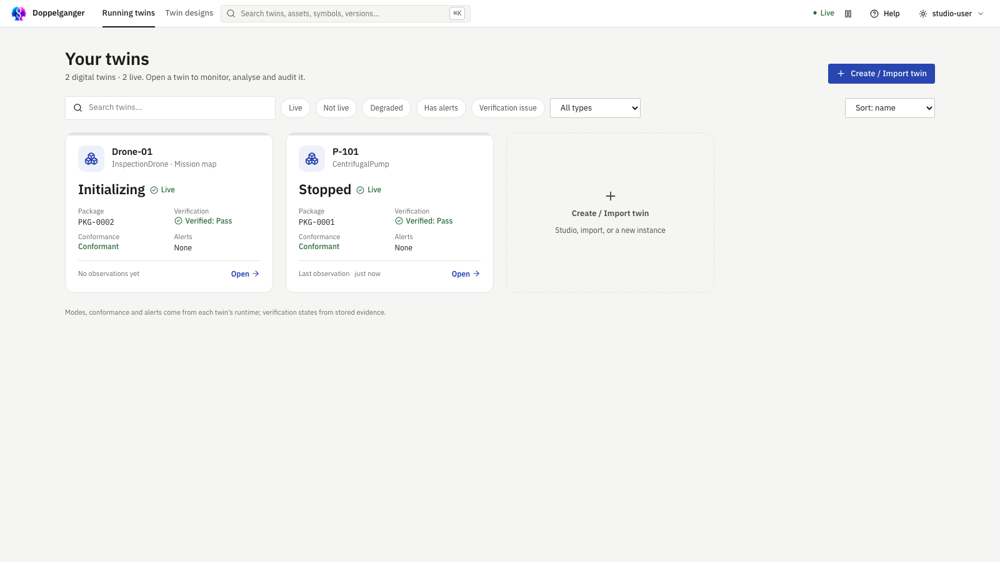

# Tutorial: connect a running twin to a real system

This tutorial starts after a twin design has been published. The [first twin tutorial](tutorial-first-twin.md) shows how to build and inspect the design; [release and deployment](blueprint-release.md) covers publication.

**For:** operators and integration engineers connecting one published design to a plant data source. **Before you start:** [run Doppelganger](installation.md), publish a design with at least one measured property, and have a test sender that can reach the service. Keep the Plant connection token private. A local test with REST takes about 15 minutes after publication.

A running twin can receive events and measurements from a PLC, gateway or historian through a REST endpoint, MQTT endpoint or subscription to an existing broker. The plant's tag names are mapped explicitly to the design's names. The runtime kernel decides whether each event is allowed in its current state and records the result.

## 1. Check the design's data

Open the published design in **Twin designs**. In Structure and Behavior, review the measured properties and events your plant will send. Use **Generated → Contract** to inspect the compiled interface. If the design needs another signal or event, create a new draft and publish a new version before connecting the plant.

For an imported or advanced design, open **Advanced → Data** and review its data contract, event names and bindings.

## 2. Create an instance with a plant connection

Open **Release → Instances → New instance** on the published design. Give the instance a stable identifier and name. Under **Data comes from**, choose **The real system (plant connection)**. Enable the REST endpoint, MQTT endpoint or broker subscription your plant uses. Choose a timestamp field and unit if messages carry time. Enter the plant's tag and event names in **Plant names**, mapping each to the corresponding twin property or event.

The centrifugal pump example has a [recorded PLC log](https://github.com/lucabrodohshl/DT_MAKER/blob/main/examples/real-twin/plc-p102.jsonl) and [connection settings](https://github.com/lucabrodohshl/DT_MAKER/blob/main/examples/real-twin/pump-p102.connection.json). These are reference data; inspect the mapping before using a different plant.

Choose **Create instance**. Its **Plant connection** page shows the endpoint address, token, topics and accepted message format for that specific running twin.

::: tip Use the displayed contract
The Plant connection page lists each accepted telemetry field and event code. Those are the names to send. Do not guess from the labels in the design: a plant binding can rename them.
:::

## 3. Deploy and send one message

In **Release → Deployment**, deploy the new instance and wait for the runtime and connection to show ready. Send a measurement or a valid event in the format shown on its Plant connection page. Use the page's example command with its actual address and token. For MQTT, publish to the shown topic; for a broker subscription, check that the twin is receiving from the configured broker.

For a REST connection, copy its URL and bearer token into your shell, then adapt this example to a field in **Message contract**:

```bash
PLANT_URL='paste the REST URL from Plant connection'
PLANT_TOKEN='paste the bearer token from Plant connection'
curl --fail-with-body --request POST "$PLANT_URL" \
  --header "Authorization: Bearer $PLANT_TOKEN" \
  --header 'Content-Type: application/json' \
  --data '{"TT101_degC": 70.2}'
```

`TT101_degC` is the pump example's temperature tag; replace it with a mapped field in your own connection. If you configured a plant timestamp, follow the page's generated command for its field and unit. The page also provides a JSON Lines replay command for a recorded log.

Open **Running twins** and select the instance. Confirm that the measurement appears under telemetry and that an event changes behavior only when the timed automaton allows it. The runtime's ledger records accepted and refused events.

**Verify success:** the Plant connection page reports a received message, the mapped value appears in the instance's telemetry, and the runtime remains available. If you also sent an event, check **Behavior** for the current state and **Audit → Ledger** for its acceptance or refusal. A successful HTTP POST alone proves delivery to the endpoint, not semantic acceptance by the kernel.



<p class="screenshot-caption">A deployed instance appears under Running twins. The seeded pump and drone are examples; your new instance will be another row.</p>

## 4. Check a deviation

Send an event the current state does not allow, or send it outside its permitted time window. The kernel refuses it and records a conformance deviation. Check the Behavior and audit views for the reason. Correct the plant mapping or revise and republish the design if the real system is behaving legitimately.

Messages without a trusted plant timestamp are placed at arrival time. Logical time cannot move backward. A missing runtime, absent data or undecidable monitor result should be shown as unavailable or unknown, not as success.

::: warning If the message does not appear
Check that the connection is enabled, the URL and bearer token match the new instance, and the JSON field is listed in **Message contract**. A refused event is different from a failed HTTP delivery: inspect the response, then the connection status and ledger before changing the design.
:::
