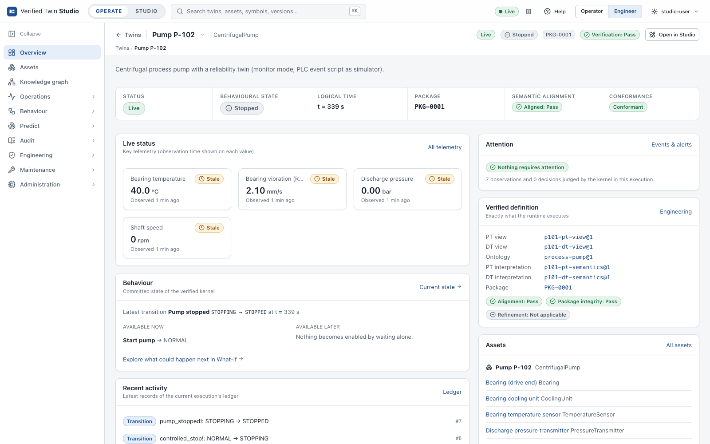
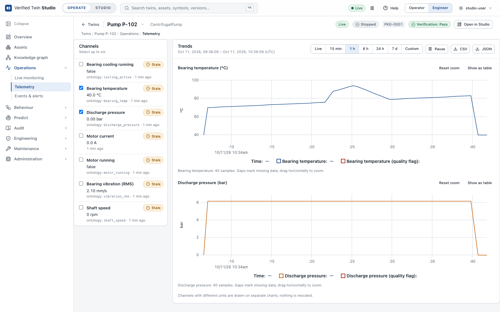
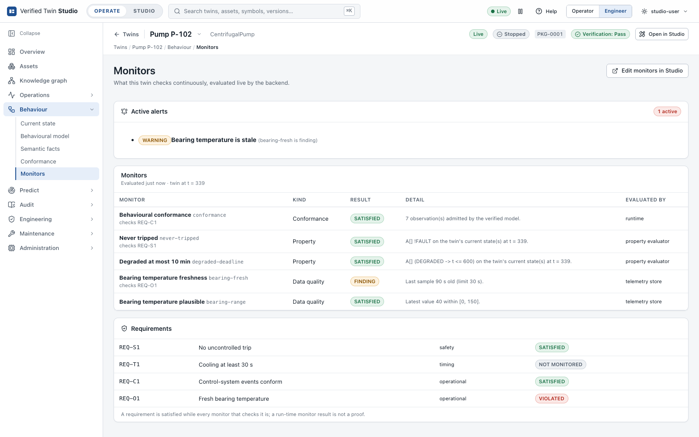
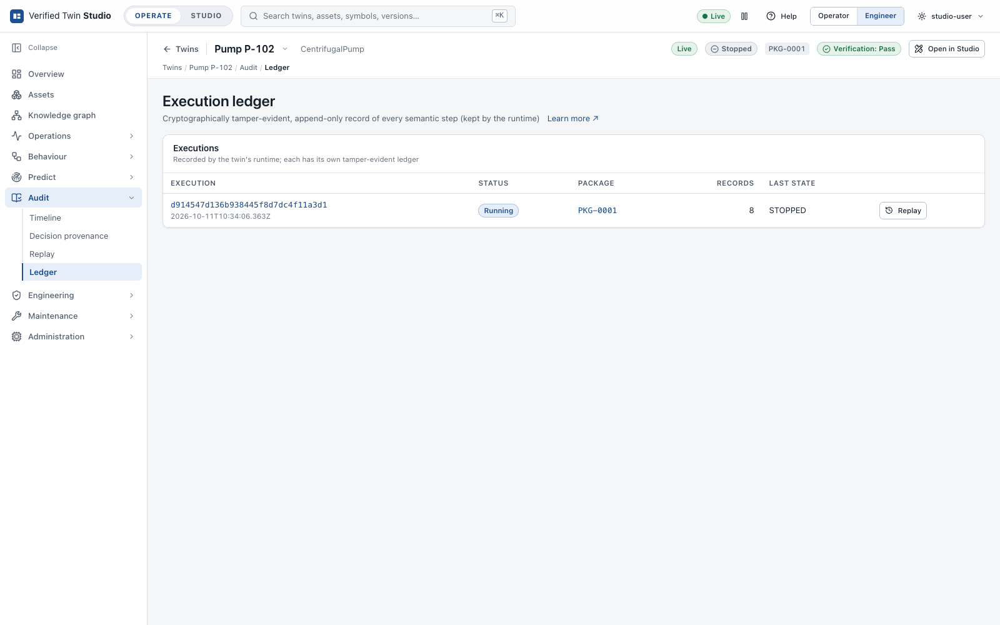
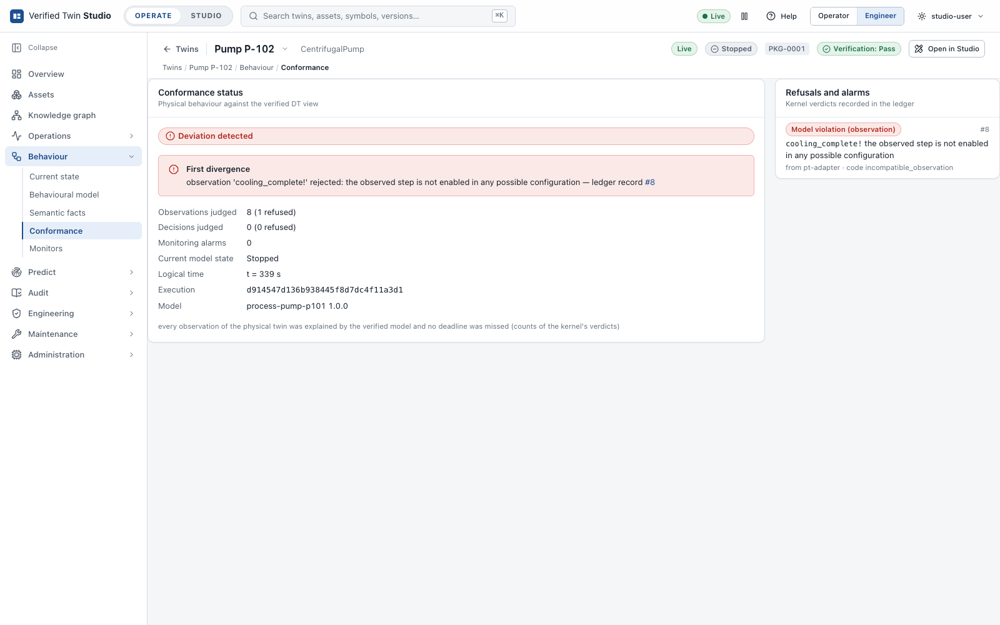
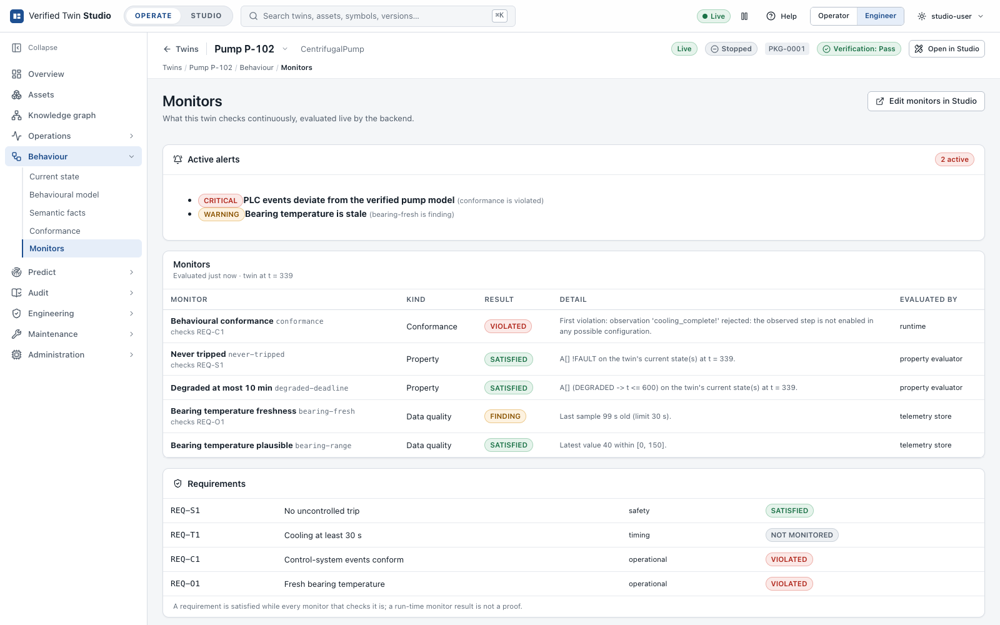

# Tutorial: connect a real twin

In this tutorial you connect a real physical system to a deployed twin. Your plant (a PLC, a
gateway or a historian) sends its events and measurements to the twin, the twin's semantic
kernel follows it step by step, and every decision is written to the instance's ledger. The
simulator is not involved.

The example is the centrifugal pump that ships with the product. The same steps work for any
published Blueprint, for example the one from [Build your first twin](tutorial-first-twin.md).
Every command and screenshot below was produced on the running product.

## How a real twin is fed

```
 plant (PLC / gateway / historian)
        │  JSON messages (MQTT, REST, log file, ...)
        ▼
 twin_bridge.py   translates names and time; decides nothing
        │  PT events + telemetry, over HTTP
        ▼
 Studio  /api/v1/twins/<instance>/runtime/...
        ▼
 twin-runtime (semantic kernel)  accepts or rejects each event → ledger
        └── telemetry → Studio history, monitors, Operate
```

Three rules apply:

- **Events use the Physical Twin's vocabulary.** These are the PT labels of the Blueprint (for
  example `start_cmd!`), not the twin's own labels. The verified label equivalence translates
  each one (for example `start_cmd!` → `restart!`).
- **The kernel decides.** An event that the verified model allows from the current state is
  accepted. Any other event is rejected, and the rejection is recorded as a conformance
  violation. Nothing else changes the twin's state.
- **Time is logical.** Events and samples carry a timestamp in the twin's logical time, which
  starts at 0 when the instance starts and never goes backwards.

## Step 1: know the contract

Open **Studio → Blueprints → Centrifugal pump → Build → Data**. Two parts of this page form the
contract with your plant:

- **Telemetry**: the field ids, types and units: `bearing_temp` (°C), `vibration_rms` (mm/s),
  `discharge_pressure` (bar), `shaft_speed` (rpm), `motor_current` (A), `cooling_active`, and
  `motor_running`.
- **Events**: each event's PT label: `start_cmd!`, `duty_up!`, `alarm_raise!`, `alarm_clear!`,
  `aux_cooling_on!`, `aux_cooling_done!`, `ramp_down_cmd!`, `halted!`, `emergency_trip!`, and
  `trip_reset!`.

The pump Blueprint declares two data sources: a simulator for previews and tests, and the
site's MQTT gateway.


## Step 2: create an instance that listens to the plant

Create the instance with only the real source. When an instance has no simulator source, its
deployment starts the twin runtime alone, and the runtime waits for your data. In the UI, open
the Blueprint's **Release → Instances → New instance** page, remove the simulator from the data
sources, and point the bindings at the real source. The same thing with the API:

```bash
curl -s http://127.0.0.1:8080/api/v1/blueprints/centrifugal-pump/versions/1 > pump.json
python3 - <<'EOF'
import json, urllib.request
conn = json.load(open("pump.json"))["document"]["connectivity"]
real = [s for s in conn["sources"] if s["kind"] != "simulator"]
bindings = [dict(b, source=real[0]["id"]) for b in conn["bindings"]]
body = {"blueprintId": "centrifugal-pump", "version": 1, "id": "pump-p102-dt", "name": "Pump P-102",
        "connectivity": {"sources": real, "bindings": bindings}}
req = urllib.request.Request("http://127.0.0.1:8080/api/v1/instances", data=json.dumps(body).encode(),
                             headers={"Content-Type": "application/json"}, method="POST")
print(urllib.request.urlopen(req).status)
EOF
```

## Step 3: deploy

Press **Deploy** on the instance, or call the API:

```bash
curl -s -X POST -H 'Content-Type: application/json' -d '{"version": 1, "reason": "connect the PLC gateway"}' \
  http://127.0.0.1:8080/api/v1/instances/pump-p102-dt/deploy
```

The supervisor starts `twin-runtime` in monitor mode, with no feed. The twin is in its initial
location, `STOPPED`, at logical time 0.

## Step 4: send a first event and a first sample by hand

```bash
T=http://127.0.0.1:8080/api/v1/twins/pump-p102-dt/runtime
curl -s -X POST -H 'Content-Type: application/json' -d '{"label": "start_cmd!", "time": "5"}' $T/pt-event
curl -s -X POST -H 'Content-Type: application/json' \
  -d '{"at": 5000, "bearing_temp": 70.2, "shaft_speed": 2950, "motor_running": true}' $T/telemetry
```

- **Events** take `time` as a decimal string in model units (seconds), or `ticks` as an integer
  (1000 ticks per second). The answer gives `accepted`, the translated label, and `from` and
  `to`.
- **Telemetry** takes `at` in ticks. Each other field must be a telemetry id, or the field that
  the Blueprint's binding selects.
- **Advancing time without events**: `POST $T/advance {"ticks": n}` moves logical time forward.
  If the plant misses a deadline of the verified model (an invariant), the advance is refused
  and recorded.

## Step 5: run the bridge

[`examples/real-twin/twin_bridge.py`](../../examples/real-twin/twin_bridge.py) needs only the
Python standard library. It maps your plant's messages to the contract.
[`pump-p102.bridge.json`](../../examples/real-twin/pump-p102.bridge.json) maps the PLC tags
(`TT101_degC`, `ST101_rpm`, …) to telemetry ids, and the PLC's event codes (`START`,
`BEARING_ALARM`, …) to PT labels. A code that is not in the map is reported and not sent.

```bash
# replay a recorded PLC log (here 10x faster than real time)
python3 examples/real-twin/twin_bridge.py --config examples/real-twin/pump-p102.bridge.json \
  --file examples/real-twin/plc-p102.jsonl --speed 10

# live from an MQTT gateway: any tool that prints one JSON message per line works
mosquitto_sub -h plc-gateway.plant-a.local -t 'plant/line4/pump/#' | \
  python3 examples/real-twin/twin_bridge.py --config examples/real-twin/pump-p102.bridge.json --stdin

# poll a REST endpoint every second
python3 examples/real-twin/twin_bridge.py --config examples/real-twin/pump-p102.bridge.json \
  --poll http://plc-gateway.plant-a.local/api/pump/p102 --interval 1
```

The recorded log drives the twin through one operating cycle:

```
connected: pump-p102-dt in STOPPED at t=0.000 (1000 ticks per unit)
t=5.000 start_cmd! -> restart! accepted (STOPPED -> NORMAL)
t=90.000 duty_up! -> increase_load! accepted (NORMAL -> NORMAL)
t=172.000 alarm_raise! -> condition_degraded! accepted (NORMAL -> DEGRADED)
t=185.000 aux_cooling_on! -> start_cooling! accepted (DEGRADED -> COOLING)
t=230.000 aux_cooling_done! -> cooling_complete! accepted (COOLING -> NORMAL)
t=330.000 ramp_down_cmd! -> controlled_stop! accepted (NORMAL -> STOPPING)
t=339.000 halted! -> pump_stopped! accepted (STOPPING -> STOPPED)
done: 7 events (0 rejected), 40 telemetry samples
```

The bridge handles time as follows:

- **With timestamps**: messages with a timestamp field (`"timestamp": {"field": "ts", "unit": "ms"}`)
  are placed relative to the first message, starting at the twin's current time.
- **Without timestamps**: the wall clock is used, and a heartbeat advances the twin's time every
  second, so a missed deadline is detected when it happens.
- **Late messages** are sent at the last time used, and the bridge says so. Logical time never
  goes backwards.

## Step 6: watch it in Operate

Open **Your Twins → Pump P-102**. The formal state, the behaviour graph, live telemetry, the
monitors and the ledger all come from the real data.







The execution ledger contains every accepted step, hash-chained:

```bash
curl -s -X POST -H 'Content-Type: application/json' -d '{}' $T/ledger/verify   # {"records": 8, "valid": true}
```



## What a deviation looks like

Here the PLC reports `aux_cooling_done!` while the pump is stopped. The verified model does not
allow that event in that state, so the kernel rejects it: the twin's state does not change, and
a conformance violation is recorded in the ledger and shown in Operate.





A deviation means that the plant and its verified model disagree. Investigate it: the plant may
have misbehaved, a signal may be wrongly mapped, or the model may need a new version. Studio
never adjusts the twin to make the data fit.

## Troubleshooting

| Symptom | Cause |
|---|---|
| `400 … not translated by the label equivalence` | The label is not a PT label of the Blueprint. Check the event map in the bridge configuration. |
| `422 time_regression` | A timestamp went backwards. Send events in time order, or let the bridge clamp late messages. |
| `503 runtime_not_connected` | The instance is not deployed or not running. Check the instance's deployment page. |
| Telemetry missing in Operate | The field name differs from the telemetry id or from the binding's selected field. |
| Event `REJECTED` | The plant did something the verified model does not allow from the twin's current state: a conformance violation, by design. |

## Limits of this version

- **No built-in connectors.** This version has no native MQTT or OPC UA client. Use the bridge,
  with `mosquitto_sub` or any tool that prints JSON lines for MQTT. REST and replay sources can
  be connection-tested in Studio.
- **No authentication.** Studio has none. Keep it on `127.0.0.1`, or put it behind an
  authenticating proxy, before you connect plant networks.
- **Logical time only.** No real-time guarantees are claimed.

Bridge self-test: `python3 examples/real-twin/test_twin_bridge.py` (also run by `ctest`).
