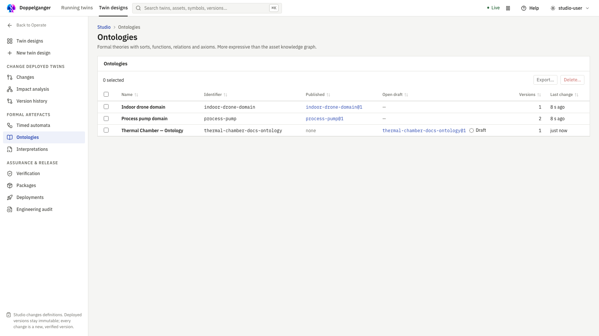
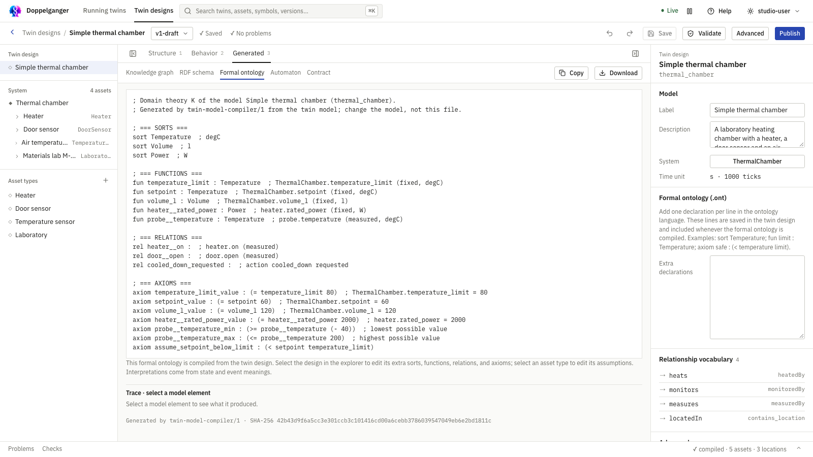

# Tutorial: evolve a twin's formal ontology

Use this workflow when a published twin needs a new formal fact or constraint. The design editor is the normal place to author semantics for a new twin; the standalone ontology editor is useful when maintaining an imported or shared versioned theory.

**For:** engineers maintaining a published formal theory or a model-driven design. **Before you start:** [run the demo](installation.md). The seeded pump and drone give you published theories to inspect. Allow about 15 minutes for a small draft change; release checks may take longer.

## 1. Find the source of the current theory

Open **Twin designs** and choose the relevant design. In **Generated → Formal ontology**, read the compiled .ont theory. Select **Twin design** in the explorer to see any extra declarations that produced it. A type's **Formal assumptions** and its properties also contribute symbols and axioms.

If the ontology is managed separately, open **Studio → Ontologies**, choose the artefact, and open its published version. The page shows the exact source and which interpretations or deployments refer to it.

The library shows published versions and open drafts. The thermal chamber draft in this screenshot was created in an isolated documentation capture, so it will not appear in a fresh demo.

## 2. Create an editable draft

A published version is immutable. In the standalone version page, create a draft from the published version. For a model-driven design, create a new design draft and edit the source model. Keep the deployed version available while you work.

## 3. Make a small change

In the design editor, change a property, add a Formal assumption to an asset type, or add a declaration under **Twin design → Formal ontology (.ont)**. For example, an axiom can constrain a fixed safety limit. In the standalone ontology editor, edit the .ont source directly.

Save. If Studio reports a syntax or unknown-symbol problem, click its diagnostic and correct the source. Inspect **Generated → Formal ontology** to verify the model-driven result.

The generated theory is read only. Change the model or the separately managed .ont draft, then compare the result.

## 4. Check the interpretation

Select the affected state or event in Behavior and review **Means**. This is the source of the generated interpretation. In the advanced Semantics area, inspect the exact versioned interpretation and its coverage. If a renamed ontology symbol appears in a formula, update that formula and save.

## 5. Validate and compare

Run **Validate** in the design editor. In the advanced ontology version page, run validation, compare the draft with the published version, and inspect symbol usage. For a change that must preserve existing meaning, run the refinement check. Read its verdict and assumptions; a syntax check alone does not prove refinement.

## 6. Review impact and release

Open **Impact analysis** for the changed version. Evidence tied to old content can become stale, so rerun the listed alignment or compilation checks. Open **Publish** on the design, complete the release gate and build a package. Deploy a new running twin version or upgrade an instance only after the package is ready.

Historical versions remain resolvable. An old execution keeps the ontology and interpretation used when it ran, so replay uses the original meanings.

**Verify success:** compare the new draft or published version with its predecessor, confirm validation reports no syntax or symbol error, and check **Impact analysis** for evidence that needs rerunning. After deployment, open the running twin's Engineering view and confirm it references the new package and ontology version. The previous version should still be available for an old execution's replay.

::: tip Check the right version
If a change does not appear in a running twin, confirm that you published a new package and deployed that version. Saving an ontology draft does not alter an already deployed instance.
:::
