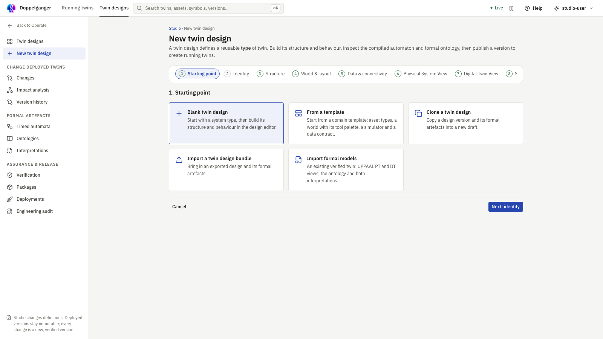
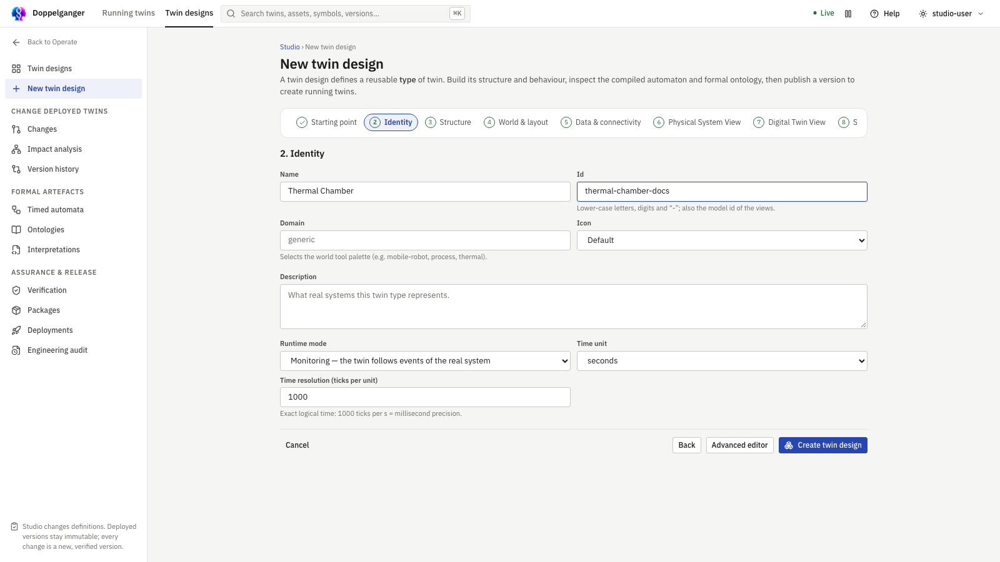
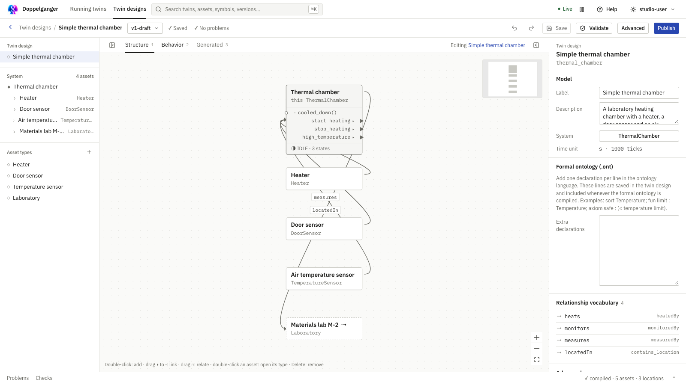
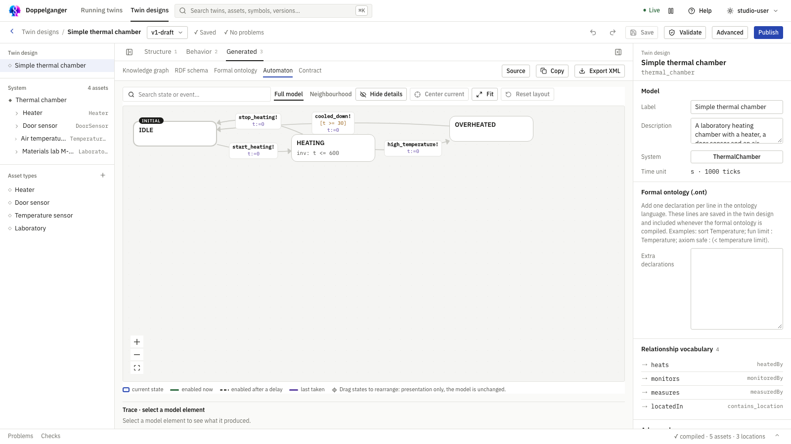

# Tutorial: create your first twin

This walkthrough builds a small thermal chamber in the new design editor. You will create one **twin design**, see its timed automaton and formal ontology generated from that design, and then learn where a **running twin** comes from. You do not need to write XML or ontology files to begin.

**For:** first-time users and engineers who want to see how one design produces formal artefacts. **Before you start:** [run the demo](installation.md) and open its URL. Allow about 20 minutes. This tutorial uses a small design; the screenshots of Structure, Behavior and Generated show the larger, complete thermal chamber example for comparison.

The [complete thermal chamber example](https://github.com/lucabrodohshl/DT_MAKER/blob/main/examples/thermal-chamber/model.json) is a reference if you want to compare your result. The steps below use a smaller version so you can finish it in one sitting.

## 1. Create a twin design

1. Open **Twin designs** in the top bar and choose **New twin design**.
2. Select **Blank twin design**, then **Next: identity**.
3. Name it **Thermal chamber**. Use an identifier such as **thermal-chamber**. Leave time as **seconds** and resolution as **1000 ticks per unit**.
4. Choose **Create twin design**. Studio opens the Structure, Behavior and Generated editor.

Select Blank twin design to author the structure and behavior yourself.

The identifier becomes a stable API and version key. Your choice may differ from the example shown.

The new design starts with a system type. It is a reusable definition, not a running chamber. You can create several running twins from a published version later.

## 2. Describe what the chamber is made of

Select the system in the left explorer. In the inspector, rename its type to **ThermalChamber** if needed. Under **Properties**, add:

| One-line entry | Meaning |
|---|---|
| temperature: real degC measured -40..200 | A measured chamber value |
| temperature_limit: real degC fixed = 80 | A fixed limit |

The one-line property box has a syntax hint below it. Select a property to adjust its kind, unit, range or fixed value in the inspector.

In **Structure**, double-click empty canvas space to add an asset. Enter **Heater** to create a new Heater type and an instance in the chamber. Open the Heater type from the explorer and add **on: boolean measured**. Return to the chamber type. The canvas shows the chamber and its heater; select a node to edit its details.

Add a reported event named **start_heating** and another named **stop_heating** in the chamber type inspector. Select each event and set **Means** to the condition it reports, such as **heater.on** and **not heater.on**. These meanings feed the interpretation generated later.

The complete example has more assets and links than this short tutorial. The same explorer, canvas and inspector appear in your new design.

## 3. Draw what the chamber can do

Open **Behavior**. Choose the chamber machine. Double-click the canvas twice to add states. Select each new state and change its **Name** to **IDLE** and **HEATING**. The first state is initial automatically; select IDLE to confirm the **Initial state** check. Give the states meanings such as **not heater.on** and **heater.on**.

Drag from IDLE's output port to HEATING, then pick **start_heating** as the trigger. Add the reverse transition with **stop_heating**. Select a state or transition to edit its meaning, timing limit, trigger, or description in the inspector.

For a timing example, select HEATING and set **At most** to **600** seconds. Studio creates the state timer **t** when you add the first state, and the generated automaton gets the limit **t <= 600**. A transition may also have a time window. Studio validates these numbers against the design's time unit.

The full example adds an OVERHEATED state and cooling transition. Your shorter version should show IDLE and HEATING with two transitions.

## 4. Edit the formal ontology in the design

Select **Twin design** at the top of the explorer. The inspector's **Formal ontology (.ont)** field accepts extra declarations in the project's ontology language, one per line. Add an axiom such as:

    axiom safe_limit : (< temperature_limit 100)

The generated ontology already includes sorts and symbols derived from types and properties. These extra declarations are saved in the design, so recompiling will include them. For an axiom scoped to one asset type, use that type's **Formal assumptions** section. This language supports sorts, functions, relations and axioms; it is richer than the RDF knowledge graph.

The generated ontology is a compiled result. Edit its source inputs in the inspector, not the generated preview. See [Ontology management](ontology-management.md) for the separate versioned ontology editor used in advanced engineering work.

::: tip Keep the first attempt small
If the axiom produces a diagnostic, remove it and first confirm that the property symbols and generated theory appear. You can return to the formal declaration after the structural and behavior model compiles.
:::

## 5. See the direct compilation

Wait for **Saved** in the header. Choose **Generated**:

- **Automaton** shows the Digital Twin timed automaton. The IDLE and HEATING states and the event transitions you drew appear here. Use **Source** or **Export XML** to inspect the UPPAAL form.
- **Formal ontology** shows the compiled .ont theory, including your axiom. The nearby **RDF schema** tab is a vocabulary projection; it is not the full formal theory.
- **Knowledge graph** shows assets and facts from Structure. It does not replace the ontology.
- The state and event **Means** fields compile into an interpretation over the ontology. Open **Advanced → Semantics → Interpretations** to inspect the versioned interpretation and its coverage.

Generated → Automaton displays the compiled machine. The complete example shown has three states; your tutorial model has two.

Generated → Formal ontology shows the actual compiled theory; edit declarations in Structure, then wait for compilation.

Select a source element in Structure or Behavior, then return to Generated to see its trace. The server performs compilation; the browser displays the result. If compilation is blocked, open **Problems**, select the reported element and fix it. **Validate** reruns the checks after saving.

## Check your draft

1. Confirm the header says **Saved** and **No problems**. If it does not, open **Problems** and select the first diagnostic.
2. In **Generated → Automaton**, find IDLE, HEATING, start_heating and stop_heating. Select HEATING and confirm the time limit is present.
3. In **Generated → Formal ontology**, find the property symbols and the axiom you entered. If the axiom is absent, confirm the source declaration saved in **Twin design → Formal ontology (.ont)**.

These checks verify that your design compiled. They do not mean the design has passed the separate release checks.

## 6. Publish and create a running twin

The design is still a draft. Choose **Publish** to open the release area, resolve the listed verification steps, build a package, and publish the version. Then create an instance from that published design under **Release → Instances**. This instance is the **running twin**. Deployment connects its runtime and, if configured, live data sources.

Publishing is a separate step because a saved design has not yet passed release checks. See [Release and deployment](blueprint-release.md) and [Connect a real twin](tutorial-connect-real-twin.md).

::: warning If Publish reports a blocked check
Read the failing check and its assumptions in the release area. A structurally valid draft is not automatically a verified package; the physical and digital views, ontology interpretations, and alignment evidence must match the release gate.
:::

## What you now have

You authored one twin design. Structure supplied asset types, properties and relationships; Behavior supplied states, events and timed transitions; meanings and formal declarations supplied the ontology and interpretation. Studio compiled these together into a timed automaton, formal theory, RDF projections and contract. A published version can be used for many running twins.
